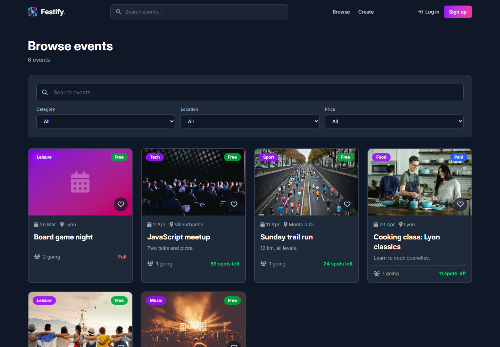

# Festify

A web app to find, create and join local events. Users browse events by category,
location or price, register in one click, save favorites and host their own events.
Admins can moderate users and events.

Built by a team of six during my Master's degree at Université Lyon 1, then
reworked by me for this repository.



## Tech stack

| Layer    | Tools |
|----------|-------|
| Backend  | Java 21, Spring Boot 4, Spring Security, Spring Data JPA, JWT (jjwt), BCrypt |
| Database | PostgreSQL 16 (H2 in tests) |
| Frontend | React 19, Vite, Redux Toolkit, React Router, Tailwind CSS |
| Tooling  | Docker Compose, GitHub Actions, JUnit 5 + MockMvc |

## Features

- Sign-up and login with stateless JWT authentication
- Event CRUD; only the creator or an admin can edit or delete an event
- Registration with a capacity limit; the creator counts as the first participant
- Search and filters (keyword, category, location, free or paid)
- Favorites and a profile page with created, upcoming and past events
- Admin dashboard to manage users and events

## Run it locally

You need Docker.

```bash
cp .env.example .env    # then set JWT_SECRET (openssl rand -base64 32) and the passwords
docker compose up --build
```

Open http://localhost:8080. If `ADMIN_EMAIL` and `ADMIN_PASSWORD` are set in `.env`,
an admin account is created on first start.

<details>
<summary>Without Docker</summary>

Start PostgreSQL, then:

```bash
# backend (http://localhost:8080)
cd backend
JWT_SECRET=<base64 key> DB_USER=... DB_PASSWORD=... ./mvnw spring-boot:run

# frontend (http://localhost:5173, proxies /api to the backend)
cd frontend
npm install
npm run dev
```
</details>

## Tests

```bash
cd backend && ./mvnw test
```

51 integration tests run the full Spring context against an in-memory H2 database.
They cover authentication, permissions (anonymous, user, event creator, admin),
capacity rules and the security fixes listed below. GitHub Actions runs them on every
push, along with the frontend lint and build.

## Project structure

```
backend/    Spring Boot REST API (controllers, services, JPA entities, security)
frontend/   React single-page app, served by nginx in Docker
docker-compose.yml   PostgreSQL + API + frontend
```

Main endpoints:

| Method | Route | Access |
|--------|-------|--------|
| POST | `/api/users`, `/api/users/login` | public |
| GET | `/api/events`, `/api/events/{id}`, `/api/events/{id}/participants` | public |
| POST, PUT, DELETE | `/api/events`, `/api/events/{id}` | logged in (creator or admin to edit) |
| POST, DELETE | `/api/events/{id}/join` | logged in |
| GET, PUT, DELETE | `/api/users/profile`, `/api/users/profile/like/{eventId}` | logged in |
| GET | `/api/users/all` | admin |

## My contribution

During the project I worked mainly on the backend:

- REST API with Spring Boot
- JWT authentication and route permissions with Spring Security
- Integration test suite (users, events, participations)
- PostgreSQL data model

After the course I reworked the project for this repository:

- Fixed security issues: users could give themselves the admin role at sign-up,
  edit other users' profiles, and plain-text passwords were stored next to the hash
- Removed the N+1 requests on event lists (participant count computed in SQL)
- Merged the duplicated create/edit forms, removed mock data and dead code
- Rewrote the Docker setup so the whole stack starts with one command
- Translated the code and the UI from French to English

## Team

Augustin Verlande, Laouratou Diallo, Hervé Yeffe, Ilicia Benaoudia,
Artémis Thomallari, Tanguy Vallot.
